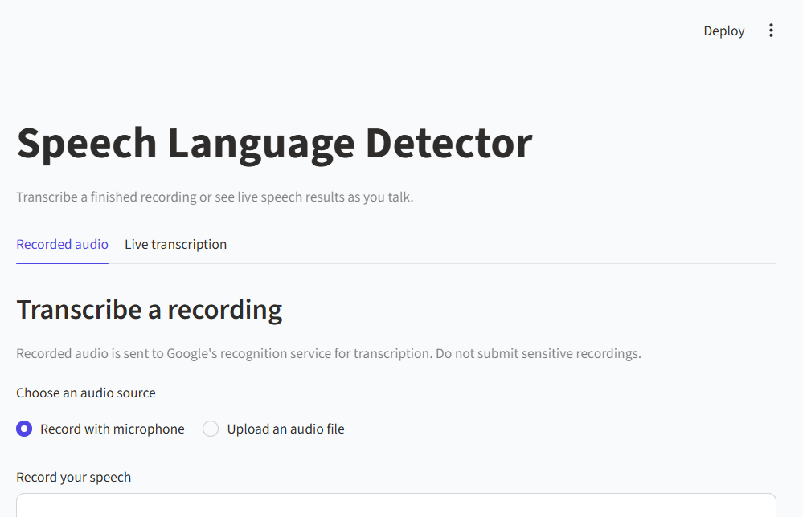
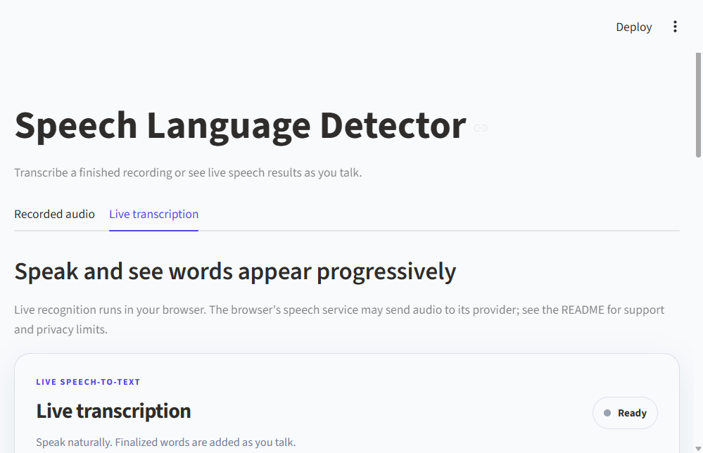

# Speech Language Detector

A small Streamlit app for turning speech into text. Use a completed browser
recording, upload an audio file, or view browser speech-recognition results
progressively while speaking.

> **Provider notice:** Audio submitted for recorded transcription is sent to
> Google's recognition service. Live mode uses the browser's speech-recognition
> service, which may send microphone audio to its own provider. Do not use this
> app with sensitive recordings unless you have reviewed the relevant providers'
> privacy terms.

## Preview

These screenshots were captured from the running application. They show the
real ready state; no recognition-result screenshot is included because a
microphone session was not authorized for this validation.





## Features

- **Recorded transcription:** record in the browser or upload WAV, AIFF, or
  FLAC audio. The app submits the complete recording to the existing
  `SpeechRecognition.recognize_google()` method.
- **Progressive live transcription:** browser `SpeechRecognition`/
  `webkitSpeechRecognition` results appear as provisional and finalized text
  arrives. This is not implemented by repeatedly submitting independent audio
  chunks to Google's one-shot method.
- **Session controls:** start, pause, resume, stop, duration, microphone status,
  and a live waveform.
- **Transcript tools:** edit, copy, clear after confirmation, and download the
  transcript with session start time, duration, and selected/detected language.
- **Language options:** choose a common recognition language or enter a BCP 47
  code. Auto mode starts with the browser's configured language; the app
  estimates a language from sufficiently long finalized text.
- **Legacy command-line mode:** `language_detector.py` remains available for
  users with a compatible local microphone setup.

## Requirements

- Python 3.10 or later.
- Internet access for the Google recorded-audio recognition request and for
  browser speech services that require a network.
- A recent Chrome or Edge browser for live transcription; browser support for
  Web Speech recognition varies. Microphone access requires `localhost` or a
  secure HTTPS context.

No API key or environment variable is required by this project. The upstream
speech services may change their availability, limits, terms, or costs; check
their current policies before relying on them.

## Installation

### Windows PowerShell

```powershell
git clone https://github.com/omarlr-pro/real-time-transcription.git
cd real-time-transcription
python -m venv .venv
.\.venv\Scripts\Activate.ps1
python -m pip install -r requirements.txt
```

### macOS or Linux

```bash
git clone https://github.com/omarlr-pro/real-time-transcription.git
cd real-time-transcription
python3 -m venv .venv
source .venv/bin/activate
python -m pip install -r requirements.txt
```

## Run the application

```console
python -m streamlit run app.py
```

Open the local address printed by Streamlit, usually
`http://localhost:8501`. In a deployed environment, serve the app over HTTPS to
allow browser microphone access. Streamlit limits uploaded files to 50 MB via
`.streamlit/config.toml`.

## Use it

### Recorded audio

1. Select **Record with microphone** and record a clip, or select **Upload an
   audio file** and choose a WAV, AIFF, or FLAC file.
2. Select **Transcribe and detect language**.
3. Review the transcript and language estimate, then download the text file.

The app decodes the complete audio file and makes one recognition request.
Recognition requires internet access and may fail because of network issues,
unsupported/corrupt audio, provider limits, or service availability. The
selected format is validated by the audio decoder; changing a filename
extension does not convert an audio file.

### Live transcription

1. Open **Live transcription** and choose the recognition language. **Auto**
   uses the browser's language preference; it does not automatically identify
   the language before recognition begins.
2. Click **Start Live Transcription** and allow microphone access.
3. Speak. Provisional text is shown separately while available; finalized
   recognition results are added to the editable transcript.
4. Pause/resume or stop. Copy or download the transcript when finished.

The waveform is generated locally using Web Audio. Audio capture and speech
recognition are browser-managed; this project does not create fixed-duration
audio chunks, run a Python streaming service, or use a separately configured
paid API.

### Language detection

The recorded workflow analyzes the returned text with `langdetect`. In live
Auto mode, language estimation starts only after at least 50 characters and
eight words have been finalized. This threshold reduces unstable guesses but
does not make short or mixed-language text reliable. The browser recognition
language determines what the live service attempts to recognize.

Arabic (Morocco) is offered as a browser recognition language code, but actual
Moroccan Darija support depends on the browser and its provider. This project
does not provide a Darija-specific model or guarantee transcription quality
for Darija.

## Architecture

```text
Streamlit UI
├── Recorded audio
│   ├── Browser recording or WAV/AIFF/FLAC upload
│   ├── audio_transcriber.py -> SpeechRecognition AudioFile
│   ├── recognize_google() -> complete text result
│   └── language_detector.py -> langdetect
└── Live transcription
    ├── live_transcription.js -> browser SpeechRecognition API
    ├── Web Audio API -> waveform only
    └── Streamlit component state -> transcript and session metadata
```

The live recognition API is browser-provided and not equally available across
browsers or platforms. The recorded `recognize_google()` call is a one-shot
request, not a streaming endpoint. Live audio is not sent through the
Streamlit component to this app's Python process; transcript and session
metadata are. Uploaded/recorded audio in the recorded tab is sent to the
Streamlit app and then to Google's recognition service.

## Privacy and configuration

- The app does not intentionally save recordings. The legacy command-line mode
  appends recognized text to the local `file.txt`.
- Recorded-tab audio passes through the Streamlit server and is submitted to
  Google's recognition service. Live audio is handled by the browser's
  recognition provider. Review their privacy terms before use.
- Do not commit credentials, private recordings, or `.streamlit/secrets.toml`.
- There are no required environment variables or API credentials.
- The browser speech service may require a network connection, may have
  provider-specific usage policies, and may not expose its own latency or
  availability guarantees.

## Tests and development

Install development dependencies and run checks:

```powershell
python -m pip install -r requirements-dev.txt
ruff check .
ruff format --check .
python -m unittest discover -s tests -v
```

The automated tests cover app rendering, supported upload UI, audio decoding
and provider-error propagation (with the remote service mocked), and language
detection/name mapping. They do not simulate browser speech recognition or
physical microphone behavior.

No end-to-end microphone session, one-minute speech run, real network outage,
provider latency, or browser permission-denial test has been measured in this
environment. Latency varies by browser, language, network, and provider; this
project does not claim a measured latency.

See [CONTRIBUTING.md](CONTRIBUTING.md) for the contribution workflow and
[SECURITY.md](SECURITY.md) for vulnerability reporting.

## Troubleshooting

- **Live mode is unavailable:** use a recent Chrome or Edge release and check
  whether the browser exposes `SpeechRecognition` or `webkitSpeechRecognition`.
- **Microphone access fails:** grant permission in browser settings, check that
  no other application has exclusive access, and use localhost or HTTPS.
- **The transcript is empty:** speak clearly, verify the selected language,
  check the network, and confirm the browser's recognition service is
  available.
- **Audio upload fails:** check that the file is a valid WAV, AIFF, or FLAC and
  is smaller than the configured 50 MB limit.
- **Language estimate is wrong:** provide more finalized speech in one
  language. Automatic text detection is not reliable for short or mixed
  content.
- **Command-line microphone is unavailable:** the optional CLI needs a
  compatible local microphone and PyAudio; the Streamlit browser workflow does
  not use the CLI's microphone backend.

## Roadmap

- Add genuine browser test coverage for permission, lifecycle controls, and
  progressive result handling.
- Evaluate a configurable streaming provider only if its credentials,
  pricing, privacy, and deployment requirements are explicit.
- Add user-reviewed real application screenshots.
- Improve audio-provider choices and robust support for long recordings.

## License and maintainer

Distributed under the [MIT License](LICENSE).

Maintained by [@omarlr-pro](https://github.com/omarlr-pro).
